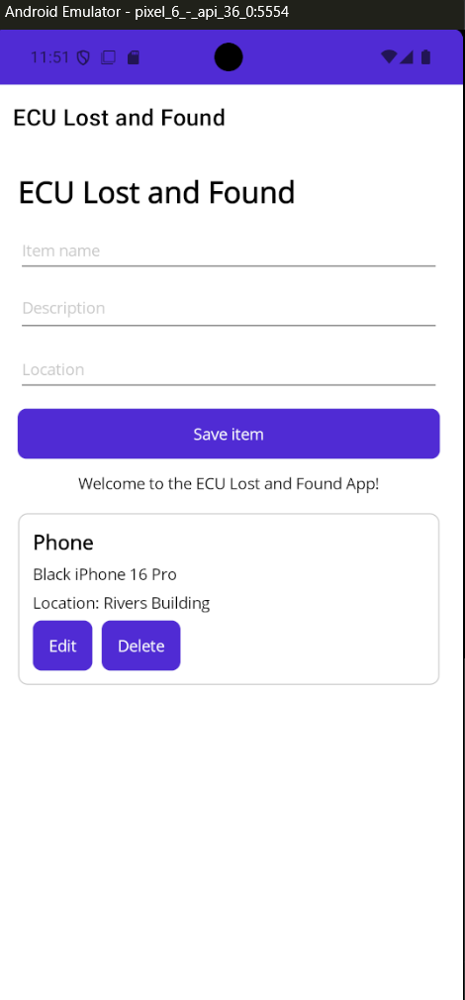
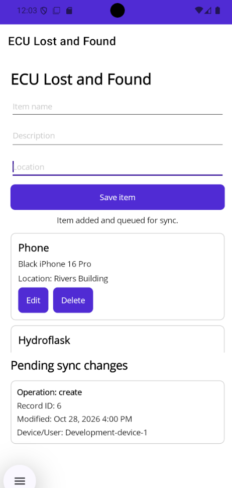

# ECU Lost and Found

> A university lost and found an application for students to find missing items they may have lost on campus.

## About
ECU lost and Found lets faculty and Students upload and browse lost items that have been found on campus and where those items were returned too.

## Prerequisites to run code
- .NET SDK version of "11.0.100-preview.7.26381.103" or newer
- .NET MAUI workload
- A working emulator

## Week 1 Progress
- Set up up Maui Project
- Set up the SQlite
- Set up the Mock API's
- Picked a Domain entity
- Template for the application was made

## Week 2 Going Forward
- Now that template is made work on adding specific components to the code
- Discuss in more detail how we want the app to look and its functions
## Week 2 Progress
- Implemented CRUD operations
- Implemented change tracking

### Before Change Screenshots
#### UI Before Change

#### Items Database Before Change

#### Change Tracking Before Change

### After Change Screenshots
#### UI After Change

#### Items Database After Change

#### Change Tracking After Changes

## Week 3 Going Forward
- Implement a push endpoint to server
- Implement  pending local changes to sync to server
- Implement pending local changes after pushing to server

## Before Pending Changes Screenshot

## After Pending Changes Implementation Screenshot

## Week 4 Going Forward
- Add request server changes newer than the device's last sync time
- Apply incoming chnages to the local database
- Be able to handle deletes (tombstones or flags)

## Week 4 Progress
- Added Conflict Handeling
- Added Sync Trigger and Automatic Sync when connected to internet
- Added Retry Sync Logic
- Added Audit Trail

## Evidence of conflict strategy working
### Steps taken
- App is ran on two seperate devices(Device A and Device B)
- Device B edits and item on the list while offline
- Device A edits the same item on the list while offline
- Device A reconnects to the internet and syncs
- Device B reconnects to the internet and syncs
- Device A resyncs and shows the changes Device B made

- App uses last Process wins rule

- Sever tracks server version and app only pulls new server versions it doesnt have

## Evidence of audit logging on device

## Evidence of audit logging synced to server

## Evidence of automatic sync attempt both (online and offline)
- Attempting to sync while in airplane mode

- Automatically Syncs when reconnected to the internet

### Video Demo of automatic sync

https://github.com/user-attachments/assets/31a4b6ef-e9a5-40f4-860f-dc8408756a56

